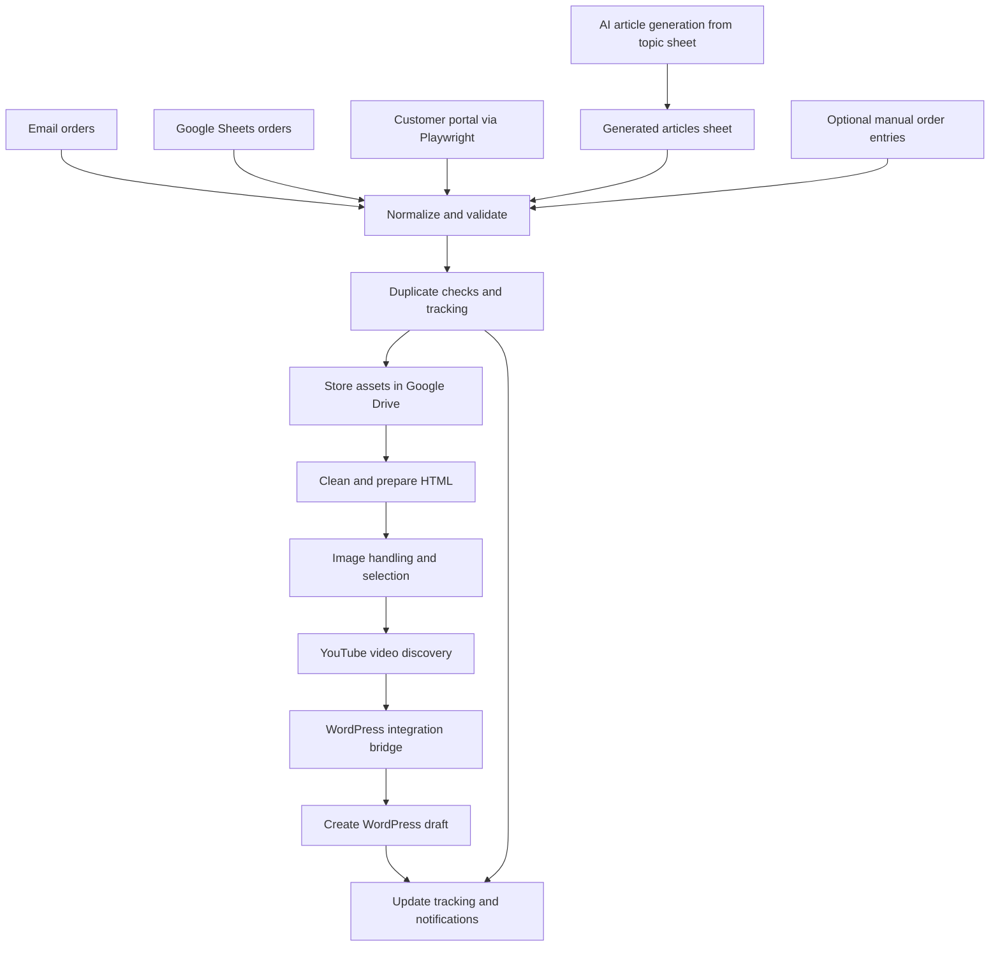

# Business Workflow Automation — Content Publishing Operations

**Production case study | Python | Playwright | Google Workspace APIs | WordPress**

A real-world business automation system I designed and built for **BlossomYourContent**, my content publishing business. It coordinates incoming customer orders, content preparation, image and video enrichment, WordPress draft creation, order tracking, and notifications across multiple systems.

> **Portfolio case study, not production source code.** This repository documents the approach, architecture, decisions, and trade-offs. It does not contain customer information, credentials, internal configuration, or the original private application code.

## The business problem

The content publishing workflow required many manual handoffs: collecting orders from different sources, retrieving articles and images, formatting content, preparing WordPress posts, updating tracking records, and communicating with customers.

The objective was to **automate the end-to-end preparation workflow through WordPress draft creation**, with optional manual order entry and operator review outside the automated run.

## Production use and business impact

The system is actively used in business operations. In one recent **75-minute working session**, a single operator handled customer orders representing **€1,637.50 in order value**, with the automated pipeline preparing WordPress drafts. The 75-minute session also included the operator's manual decisions and client communication, but those actions were not required for the pipeline itself to run.

This amount describes **the value of orders handled**, not sales generated by the automation. It is not a measured time-saving percentage against a manual baseline.

## Architecture overview

This diagram simplifies the workflow. The supporting documents describe operational checks and human intervention.

## Key capabilities

- **Multi-source intake:** email, Google Sheets, a customer portal accessed with Playwright, and a generated-articles sheet; manual order entry is also supported.
- **AI article generation:** read article topics from a sheet, combine instructions based on multiple criteria, generate articles with AI, and write the results to a sheet used by the publishing pipeline.
- **Article preparation:** HTML normalization, link preservation, and publication-ready formatting.
- **Image workflow:** customer-provided images and provider image sourcing with automated preparation.
- **Video enrichment:** look for a relevant video on the client's YouTube channel, or search a curated list of trusted channels when the client has none.
- **WordPress integration:** media handling, draft post creation, and category coordination through a dedicated bridge.
- **Central tracking:** order statuses, stored assets, draft/published links, and failure information.
- **Operational safeguards:** separate test/live execution profiles and configurable external side effects.
- **Feedback:** order-level notifications and processing-run summaries.

## Supporting documentation

- [System architecture](docs/architecture.md)
- [Order processing workflow](docs/workflow.md)
- [Engineering decisions and QA approach](docs/engineering-decisions.md)

## My role

I identified the business problem, designed the workflow and operational safeguards, and built and iterated on the automation. The work combined business-process analysis, Python and browser automation, third-party integrations, and QA-style risk management.

## Scope and limitations

This is an **architectural case study, not a runnable application**. Sensitive production details, customer data, and source files are intentionally excluded. Execution profiles control whether specific actions are performed. The publishing pipeline runs unattended through WordPress draft creation. Manual order additions and later human review/communication are optional or separate activities.
