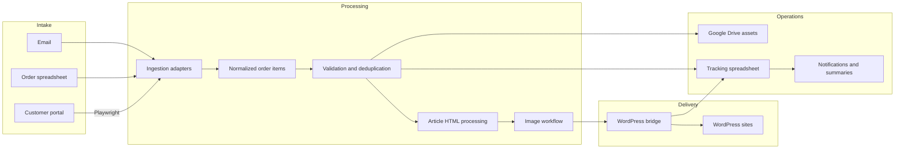

# Architecture and system boundaries

## System overview

## Components

**Ingestion adapters.** Orders arrive through email, a Google Sheets intake, or a customer portal. Browser automation with Playwright bridges the portal where a direct API integration is not available. Each source has different identifiers and writeback requirements.

**Shared processing.** Incoming order details are normalized before validation. Duplicate checks are important because orders can reappear in later runs or arrive through repeated source reads.

**Google Drive.** Stores organized working assets and evidence associated with individual orders: article documents, processed content, images, and relevant source artifacts.

**Content and image preparation.** Incoming documents are cleaned for web publication, preserving important links and structure. The image workflow considers customer assets and suitable provider imagery, with human choice where appropriate.

**WordPress bridge.** A separate integration layer handles WordPress operations such as media upload, post creation, and category interactions.

**Central tracking.** A spreadsheet provides an operational view of each order, including its processing status, publication/draft information, stored resources, and failures.

**Notifications.** Per-order feedback and end-of-run reports make processing results visible.

## Boundaries and assumptions

- Several components interact with third-party services and are subject to their availability, formats, and rate limits.
- A prepared WordPress draft is not the same as a publicly published article.
- Some orders may need manual intervention; the workflow is intentionally not fully autonomous.
- This diagram abstracts internal modules and does not disclose endpoints, tokens, customer information, or site inventory.
