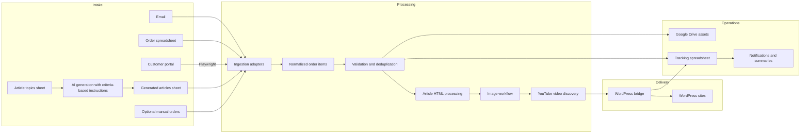

# Architecture and system boundaries

## System overview

## Components

**Ingestion adapters.** Orders arrive through email, a Google Sheets intake, a generated-articles sheet, or a customer portal. Browser automation with Playwright bridges the portal where a direct API integration is not available. Each source has different identifiers and writeback requirements.

**AI article source.** A separate generation process reads topics from a spreadsheet, assembles instructions based on multiple criteria, generates articles, and saves completed articles to another sheet. That sheet feeds the shared publishing pipeline. Manual order entry is also supported.

**Shared processing.** Incoming order details are normalized before validation. Duplicate checks are important because orders can reappear in later runs or arrive through repeated source reads.

**Google Drive.** Stores organized working assets and evidence associated with individual orders: article documents, processed content, images, and relevant source artifacts.

**Content and image preparation.** Incoming documents are cleaned for web publication, preserving important links and structure. The image workflow considers customer assets and suitable provider imagery, and video discovery. Video lookup prioritizes the client's YouTube channel when available, falling back to a curated list of trusted channels.

**WordPress bridge.** A separate integration layer handles WordPress operations such as media upload, draft creation, and category interactions.

**Central tracking.** A spreadsheet provides an operational view of each order, including its processing status, publication/draft information, stored resources, and failures.

**Notifications.** Per-order feedback and end-of-run reports make processing results visible.

## Boundaries and assumptions

- Several components interact with third-party services and are subject to their availability, formats, and rate limits.
- The automated pipeline runs without human intervention through WordPress draft creation. A draft is not a publicly published article.
- Operators can add orders manually, but manual entry is not required for normal automated execution.
- This diagram abstracts internal modules and does not disclose endpoints, tokens, customer information, or site inventory.
